# MidProject-Jarkom-K4

**Kelompok** : K-4

**Anggota** :

| Nama                 | NRP        |
| -------------------- | ---------- |
| Putri Permata Sabila | 5027251047 |
| M.Faris Roisul Azhar | 5027251048 |
| Izzat Ilham Wahyudi  | 5027251062 |

## Daftar Isi

---

## Laporan Resmi (Tahap 1 - Infrastruktur dan Routing Statis)

### 1. Topologi dan Pengalamatan IP

#### 1.1 Rancangan Topologi

Fase pertama membangun topologi jaringan Smart City Surabaya pada Cisco Packet Tracer. Topologi terdiri dari 7 _router_ wilayah (R-PUSAT, R-DC, R-UTARA, R-PELABUHAN, R-BARAT, R-TIMUR, R-SELATAN) dan 1 _router_ penyedia internet (R-ISP). R-PUSAT menjadi titik transit yang terhubung langsung ke R-DC, R-UTARA, R-SELATAN, R-TIMUR, dan R-BARAT. R-PELABUHAN terhubung ke R-UTARA melalui link L6.

Pengalamatan IP menggunakan skema _Variable Length Subnet Mask_ (VLSM) pada blok privat `10.32.0.0/16` agar penggunaan alamat lebih efisien.

**Perangkat yang digunakan:**

| Perangkat  | Jumlah | Model                                 | Keterangan                                                                                                        |
| ---------- | :----: | ------------------------------------- | ----------------------------------------------------------------------------------------------------------------- |
| Router     |   8    | PT-Router + modul `PT-ROUTER-NM-1CGE` | 7 router wilayah dan R-ISP. Semua antarmuka GigabitEthernet agar kapasitas _backbone_ realistis untuk skala kota. |
| Switch     |   14   | Cisco 2960                            | Satu switch untuk setiap LAN.                                                                                     |
| End Device |   14   | PC / Server                           | Satu perwakilan untuk setiap LAN.                                                                                 |

**Jenis kabel yang digunakan:**

| Koneksi                       | Jenis Kabel             |
| ----------------------------- | ----------------------- |
| Router ke Switch              | Copper Straight-Through |
| Switch ke PC / Server         | Copper Straight-Through |
| Router ke Router (_backbone_) | Copper Cross-Over       |

**Link point-to-point (/30):**

| Link | Router A | IP Router A    | Router B    | IP Router B    | Network           |
| ---- | -------- | -------------- | ----------- | -------------- | ----------------- |
| L1   | R-PUSAT  | `10.32.241.33` | R-DC        | `10.32.241.34` | `10.32.241.32/30` |
| L2   | R-PUSAT  | `10.32.241.37` | R-UTARA     | `10.32.241.38` | `10.32.241.36/30` |
| L3   | R-PUSAT  | `10.32.241.41` | R-SELATAN   | `10.32.241.42` | `10.32.241.40/30` |
| L4   | R-PUSAT  | `10.32.241.45` | R-TIMUR     | `10.32.241.46` | `10.32.241.44/30` |
| L5   | R-PUSAT  | `10.32.241.49` | R-BARAT     | `10.32.241.50` | `10.32.241.48/30` |
| L6   | R-UTARA  | `10.32.241.53` | R-PELABUHAN | `10.32.241.54` | `10.32.241.52/30` |
| ISP  | R-PUSAT  | `203.0.113.17` | R-ISP       | `203.0.113.18` | `203.0.113.16/30` |

**Alasan Pemilihan Skema VLSM:**

Skema VLSM dipilih karena kebutuhan host tiap LAN sangat bervariasi, mulai dari LAN WiFi Publik berukuran `/18` hingga link _point-to-point_ berukuran `/30`. Dengan VLSM, setiap segmen mendapat blok yang sesuai kebutuhan sehingga tidak ada alamat yang terbuang, sedangkan skema berukuran tetap akan memaksa link yang hanya membutuhkan 2 alamat memakai blok sebesar LAN publik. Blok dialokasikan berurutan dari prefix terbesar ke terkecil sehingga tidak ada alamat yang saling tumpang tindih, dan alamat _gateway_ tiap LAN dipetakan pada alamat host pertama.

**Alasan Desain Topologi:**

- R-PUSAT ditempatkan sebagai pusat (_hub_) yang terhubung ke seluruh router wilayah sesuai arsitektur _backbone_ pada soal. Susunan ini menyederhanakan routing statis karena router cabang cukup memakai satu _default route_ ke R-PUSAT.
- R-PELABUHAN terhubung melalui R-UTARA (link L6) sesuai skema pada soal. Karena itu R-UTARA memerlukan rute spesifik ke arah pelabuhan.
- Setiap LAN memakai satu switch dan satu perangkat perwakilan sehingga tiap _subnet_ terpusat pada switch masing-masing, sementara router berperan menghubungkan antar _subnet_.
- Link antar-router memakai prefix `/30` karena hanya membutuhkan dua alamat host.
- Seluruh router memakai antarmuka GigabitEthernet agar kapasitas _backbone_ realistis untuk skala kota, terutama R-PUSAT yang menampung 8 koneksi aktif (2 LAN, 5 link cabang, dan 1 link ISP).

**Output Topologi**

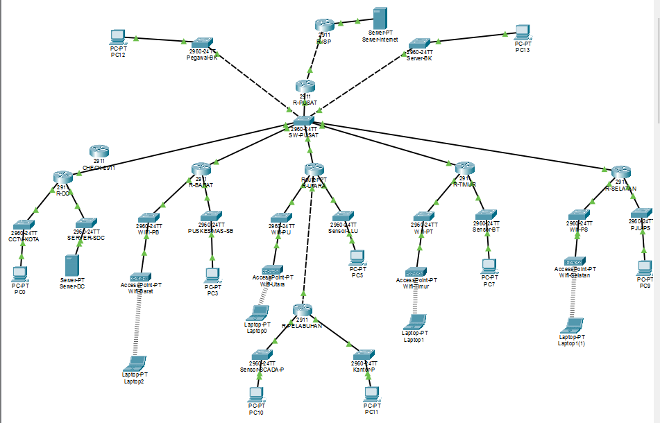

#### 1.2 Konfigurasi IP Antarmuka Router

Setiap jaringan lokal (LAN) memerlukan alamat _gateway_ yang dipasang pada antarmuka (_interface_) _router_ untuk menjembatani komunikasi keluar dari _subnet_ tersebut. Konfigurasi dilakukan melalui CLI karena pengisian IP lewat antarmuka grafis (GUI) membuat Packet Tracer mengubah _subnet mask_ secara otomatis menjadi `255.0.0.0` (kelas A).

Berikut templat dasar yang digunakan pada seluruh _router_:

```
Router> enable
Router# configure terminal
Router(config)# hostname [nama_router]
[nama_router](config)# interface [nama_port_interface]
[nama_router](config-if)# ip address [IP_Gateway] [Subnet_Mask]
[nama_router](config-if)# no shutdown
[nama_router](config-if)# exit
[nama_router](config)# exit
[nama_router]# write memory
```

Perintah `no shutdown` wajib dijalankan pada kedua ujung link agar indikator kabel berubah menjadi hijau. Perangkat akhir (PC) dikonfigurasi manual melalui **Desktop > IP Configuration** dan diarahkan ke _gateway_ router wilayahnya.

#### 1.3 Alokasi IP per Wilayah

Interface router dan server dikonfigurasi statis sesuai tabel subnetting (alamat gateway adalah alamat host pertama tiap subnet). Perangkat pengguna (PC dan laptop) mendapat IP, gateway, dan DNS otomatis dari DHCP, dijelaskan di bagian DHCP.

Setiap wilayah dibuktikan dengan dua perintah di router:

- `show ip interface brief`: memastikan alamat tiap interface sesuai tabel dan statusnya up/up.
- `show ip route connected`: memastikan network ID dan prefix (subnet mask) tiap LAN sesuai tabel.

##### A. Wilayah Pusat (R-PUSAT)

| LAN                                   | Perangkat | IP Address    | Subnet Mask       |
| ------------------------------------- | --------- | ------------- | ----------------- |
| Pegawai Balai Kota (`10.32.224.0/21`) | Router    | `10.32.224.1` | `255.255.248.0`   |
| Server Balai Kota (`10.32.241.0/27`)  | Router    | `10.32.241.1` | `255.255.255.224` |
|                                       | Server    | `10.32.241.2` | `255.255.255.224` |

**Output R-PUSAT**

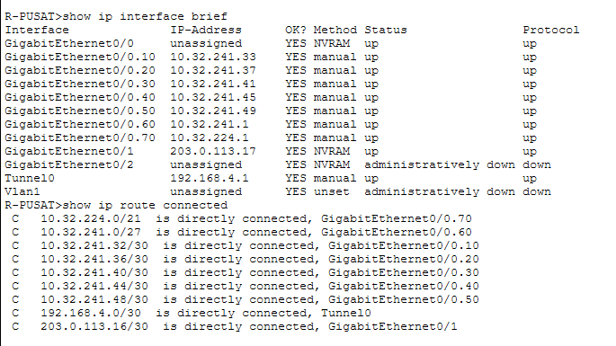

Subinterface `GigabitEthernet0/0.70` berada di `10.32.224.1` dan `GigabitEthernet0/0.60` di `10.32.241.1`, keduanya up/up.

Muncul `C 10.32.224.0/21` dan `C 10.32.241.0/27`, sesuai network ID dan prefix pada tabel.

##### B. Wilayah Data Center (R-DC)

| LAN                                      | Perangkat | IP Address    | Subnet Mask     |
| ---------------------------------------- | --------- | ------------- | --------------- |
| CCTV Kota (`10.32.96.0/19`)              | Router    | `10.32.96.1`  | `255.255.224.0` |
| Server dan Storage DC (`10.32.239.0/24`) | Router    | `10.32.239.1` | `255.255.255.0` |
|                                          | Server    | `10.32.239.2` | `255.255.255.0` |

**Output R-DC**

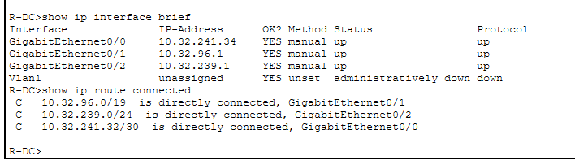

Interface LAN CCTV berada di `10.32.96.1` dan LAN Server DC di `10.32.239.1`, keduanya up/up.

Muncul `C 10.32.96.0/19` dan `C 10.32.239.0/24`.

##### C. Wilayah Utara (R-UTARA)

| LAN                                         | Perangkat | IP Address    | Subnet Mask     |
| ------------------------------------------- | --------- | ------------- | --------------- |
| WiFi Publik Utara (`10.32.0.0/18`)          | Router    | `10.32.0.1`   | `255.255.192.0` |
| Sensor Lalu Lintas Utara (`10.32.236.0/23`) | Router    | `10.32.236.1` | `255.255.254.0` |

**Output R-UTARA**

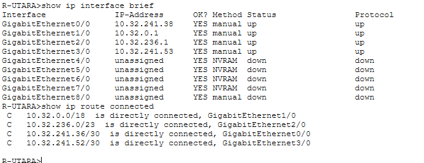

Interface WiFi Utara berada di `10.32.0.1` dan Sensor Lalu Lintas di `10.32.236.1`, keduanya up/up.

Muncul `C 10.32.0.0/18` dan `C 10.32.236.0/23`.

##### D. Wilayah Pelabuhan (R-PELABUHAN)

| LAN                                 | Perangkat | IP Address    | Subnet Mask       |
| ----------------------------------- | --------- | ------------- | ----------------- |
| Sensor dan SCADA (`10.32.160.0/19`) | Router    | `10.32.160.1` | `255.255.224.0`   |
| Kantor Pelabuhan (`10.32.240.0/25`) | Router    | `10.32.240.1` | `255.255.255.128` |

**Output R-PELABUHAN**

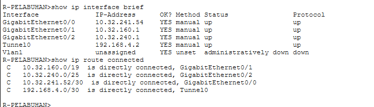

Interface SCADA berada di `10.32.160.1` dan Kantor Pelabuhan di `10.32.240.1`, keduanya up/up.

Muncul `C 10.32.160.0/19` dan `C 10.32.240.0/25`.

##### E. Wilayah Barat (R-BARAT)

| LAN                                      | Perangkat | IP Address    | Subnet Mask     |
| ---------------------------------------- | --------- | ------------- | --------------- |
| WiFi Publik Barat (`10.32.192.0/19`)     | Router    | `10.32.192.1` | `255.255.224.0` |
| Puskesmas dan Sekolah (`10.32.238.0/24`) | Router    | `10.32.238.1` | `255.255.255.0` |

**Output R-BARAT**

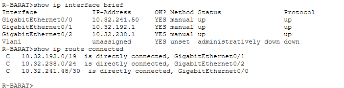

Interface WiFi Barat berada di `10.32.192.1` dan Puskesmas dan Sekolah di `10.32.238.1`, keduanya up/up.

Muncul `C 10.32.192.0/19` dan `C 10.32.238.0/24`.

##### F. Wilayah Timur (R-TIMUR)

| LAN                                    | Perangkat | IP Address    | Subnet Mask     |
| -------------------------------------- | --------- | ------------- | --------------- |
| WiFi Publik Timur (`10.32.128.0/19`)   | Router    | `10.32.128.1` | `255.255.224.0` |
| Sensor Banjir Timur (`10.32.232.0/22`) | Router    | `10.32.232.1` | `255.255.252.0` |

**Output R-TIMUR**

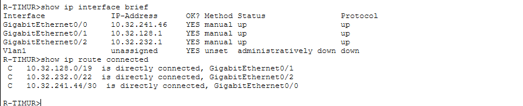

Interface WiFi Timur berada di `10.32.128.1` dan Sensor Banjir di `10.32.232.1`, keduanya up/up.

Muncul `C 10.32.128.0/19` dan `C 10.32.232.0/22`.

##### G. Wilayah Selatan (R-SELATAN)

| LAN                                     | Perangkat | IP Address      | Subnet Mask       |
| --------------------------------------- | --------- | --------------- | ----------------- |
| WiFi Publik Selatan (`10.32.64.0/19`)   | Router    | `10.32.64.1`    | `255.255.224.0`   |
| PJU Pintar Selatan (`10.32.240.128/25`) | Router    | `10.32.240.129` | `255.255.255.128` |

**Output R-SELATAN**

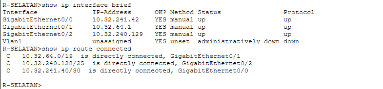

Interface WiFi Selatan berada di `10.32.64.1` dan PJU Pintar di `10.32.240.129`, keduanya up/up.

Muncul `C 10.32.64.0/19` dan `C 10.32.240.128/25`.

---

### 2. Konfigurasi Routing Statis (Static Routing)

Agar setiap _subnet_ di wilayah yang berbeda dapat saling bertukar paket data, rute statis diterapkan pada seluruh infrastruktur _backbone_. Seluruh _router_ cabang dikonfigurasi dengan _default route_ (`0.0.0.0 0.0.0.0`) yang mengarah ke R-PUSAT untuk meringkas entri perutean. R-PUSAT bertindak sebagai titik transit pusat dan dikonfigurasi dengan rute statis spesifik menuju setiap _subnet_ LAN (utama dan kedua) di bawah masing-masing cabang. Rute dua arah ini memastikan paket berangkat maupun paket balasan (_return route_) sama-sama memiliki jalur.

#### 2.1 Default Route pada Router Cabang

| Router      | Next-hop (antarmuka R-PUSAT / R-UTARA) | Keterangan            |
| ----------- | -------------------------------------- | --------------------- |
| R-DC        | `10.32.241.33`                         | Menuju R-PUSAT via L1 |
| R-UTARA     | `10.32.241.37`                         | Menuju R-PUSAT via L2 |
| R-SELATAN   | `10.32.241.41`                         | Menuju R-PUSAT via L3 |
| R-TIMUR     | `10.32.241.45`                         | Menuju R-PUSAT via L4 |
| R-BARAT     | `10.32.241.49`                         | Menuju R-PUSAT via L5 |
| R-PELABUHAN | `10.32.241.53`                         | Menuju R-UTARA via L6 |

Contoh konfigurasi pada R-UTARA:

```
R-UTARA> enable
R-UTARA# configure terminal
R-UTARA(config)# ip route 0.0.0.0 0.0.0.0 10.32.241.37
R-UTARA(config)# exit
R-UTARA# write memory
```

#### 2.2 Rute Tambahan pada R-UTARA

R-PELABUHAN berada di bawah R-UTARA, sehingga R-UTARA memerlukan rute spesifik ke arah bawah menuju kedua LAN pelabuhan. Tanpa rute ini, paket balasan dari R-PUSAT untuk wilayah pelabuhan dikembalikan lagi ke R-PUSAT oleh _default route_.

```
R-UTARA> enable
R-UTARA# configure terminal
R-UTARA(config)# ip route 10.32.160.0 255.255.224.0 10.32.241.54
R-UTARA(config)# ip route 10.32.240.0 255.255.255.128 10.32.241.54
R-UTARA(config)# exit
R-UTARA# write memory
```

#### 2.3 Static Route pada R-PUSAT

| Tujuan                     | Network         | Subnet Mask       | Next-hop                     |
| -------------------------- | --------------- | ----------------- | ---------------------------- |
| WiFi Publik Utara          | `10.32.0.0`     | `255.255.192.0`   | `10.32.241.38` (R-UTARA)     |
| WiFi Publik Selatan        | `10.32.64.0`    | `255.255.224.0`   | `10.32.241.42` (R-SELATAN)   |
| CCTV Kota                  | `10.32.96.0`    | `255.255.224.0`   | `10.32.241.34` (R-DC)        |
| WiFi Publik Timur          | `10.32.128.0`   | `255.255.224.0`   | `10.32.241.46` (R-TIMUR)     |
| WiFi Publik Barat          | `10.32.192.0`   | `255.255.224.0`   | `10.32.241.50` (R-BARAT)     |
| Server dan Storage DC      | `10.32.239.0`   | `255.255.255.0`   | `10.32.241.34` (R-DC)        |
| Sensor Lalu Lintas Utara   | `10.32.236.0`   | `255.255.254.0`   | `10.32.241.38` (R-UTARA)     |
| Sensor dan SCADA Pelabuhan | `10.32.160.0`   | `255.255.224.0`   | `10.32.241.38` (via R-UTARA) |
| Kantor Pelabuhan           | `10.32.240.0`   | `255.255.255.128` | `10.32.241.38` (via R-UTARA) |
| Link L6                    | `10.32.241.52`  | `255.255.255.252` | `10.32.241.38` (R-UTARA)     |
| PJU Pintar Selatan         | `10.32.240.128` | `255.255.255.128` | `10.32.241.42` (R-SELATAN)   |
| Sensor Banjir Timur        | `10.32.232.0`   | `255.255.252.0`   | `10.32.241.46` (R-TIMUR)     |
| Puskesmas dan Sekolah      | `10.32.238.0`   | `255.255.255.0`   | `10.32.241.50` (R-BARAT)     |
| Default route (internet)   | `0.0.0.0`       | `0.0.0.0`         | `203.0.113.18` (R-ISP)       |

**Konfigurasi Static Route Lengkap pada R-PUSAT:**

```
R-PUSAT> enable
R-PUSAT# configure terminal
R-PUSAT(config)# ip route 10.32.0.0 255.255.192.0 10.32.241.38
R-PUSAT(config)# ip route 10.32.64.0 255.255.224.0 10.32.241.42
R-PUSAT(config)# ip route 10.32.96.0 255.255.224.0 10.32.241.34
R-PUSAT(config)# ip route 10.32.128.0 255.255.224.0 10.32.241.46
R-PUSAT(config)# ip route 10.32.192.0 255.255.224.0 10.32.241.50
R-PUSAT(config)# ip route 10.32.239.0 255.255.255.0 10.32.241.34
R-PUSAT(config)# ip route 10.32.236.0 255.255.254.0 10.32.241.38
R-PUSAT(config)# ip route 10.32.160.0 255.255.224.0 10.32.241.38
R-PUSAT(config)# ip route 10.32.240.0 255.255.255.128 10.32.241.38
R-PUSAT(config)# ip route 10.32.241.52 255.255.255.252 10.32.241.38
R-PUSAT(config)# ip route 10.32.240.128 255.255.255.128 10.32.241.42
R-PUSAT(config)# ip route 10.32.232.0 255.255.252.0 10.32.241.46
R-PUSAT(config)# ip route 10.32.238.0 255.255.255.0 10.32.241.50
ip route 0.0.0.0 0.0.0.0 203.0.113.18
R-PUSAT(config)# exit
R-PUSAT# write memory
```

#### 2.4 Verifikasi Tabel Rute R-PUSAT

Tabel rute R-PUSAT menjadi tolok ukur utama keberhasilan pendaftaran rute. Keluaran `show ip route` memvalidasi bahwa titik pusat telah mengetahui jalur (_next-hop_) menuju seluruh _subnet_ di setiap wilayah.

```
R-PUSAT# show ip route
Gateway of last resort is 203.0.113.13 to network 0.0.0.0

     10.0.0.0/8 is variably subnetted, 20 subnets, 9 masks
S       10.32.0.0/18 [1/0] via 10.32.241.38
S       10.32.64.0/19 [1/0] via 10.32.241.42
S       10.32.96.0/19 [1/0] via 10.32.241.34
S       10.32.128.0/19 [1/0] via 10.32.241.46
S       10.32.160.0/19 [1/0] via 10.32.241.38
S       10.32.192.0/19 [1/0] via 10.32.241.50
C       10.32.224.0/21 is directly connected, GigabitEthernet3/0
S       10.32.232.0/22 [1/0] via 10.32.241.46
S       10.32.236.0/23 [1/0] via 10.32.241.38
S       10.32.238.0/24 [1/0] via 10.32.241.50
S       10.32.239.0/24 [1/0] via 10.32.241.34
S       10.32.240.0/25 [1/0] via 10.32.241.38
S       10.32.240.128/25 [1/0] via 10.32.241.42
...
```

---

### 3. Pengujian Konektivitas (Ping dan Tracert)

Pengujian memvalidasi bahwa setiap PC dari _subnet_ yang berbeda dapat saling berkomunikasi secara utuh (_end-to-end connectivity_). Seluruh pengujian dilakukan melalui **Command Prompt** pada PC.

#### A. Uji Koneksi Lokal ke Gateway

Memastikan PC CCTV Kota di wilayah R-DC terhubung secara logis dan fisik ke antarmuka router wilayahnya.

```
C:\> ping 10.32.96.1
```

**Output**

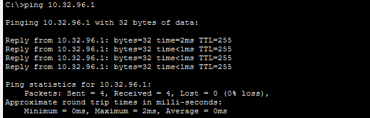

#### B. Uji Koneksi Lintas Subnet Terpusat (PC CCTV ke PC Pegawai Balai Kota)

Memastikan paket dari R-DC mampu mencapai _subnet_ target di R-PUSAT dan rute balasan beroperasi normal.

```
C:\> ping 10.32.224.2
```

**Output**

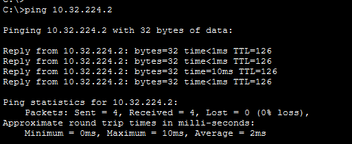

#### C. Uji Koneksi Antar Cabang Utama (PC CCTV ke PC WiFi Publik Utara)

Memastikan perutean transit di R-PUSAT meneruskan data dengan akurat antar dua wilayah cabang.

```
C:\> ping 10.32.0.2
```

**Output**

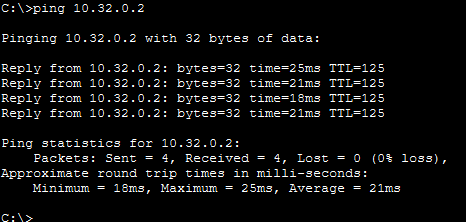

#### D. Uji Koneksi Antar Cabang Subnet Kedua (PC CCTV ke PC Sensor Lalu Lintas Utara)

Memastikan R-PUSAT merespons menggunakan rute statis spesifik menuju LAN kedua dari wilayah cabang tujuan.

```
C:\> ping 10.32.236.2
```

**Output**

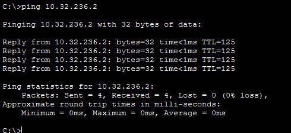

#### E. Uji Koneksi Multi-Hop (PC Pegawai Balai Kota ke PC SCADA Pelabuhan)

Memastikan paket data berhasil menembus tautan bertingkat (R-PUSAT, R-UTARA, lalu R-PELABUHAN) beserta rute baliknya.

```
C:\> ping 10.32.160.2
```

**Output**

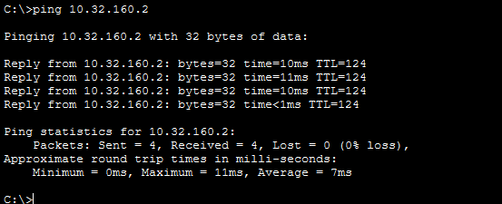

#### F. Pelacakan Jalur (Tracert)

Memetakan setiap lompatan (_hop_) dari PC CCTV Kota menuju PC SCADA di Pelabuhan untuk memverifikasi jalur aktual dan memastikan tidak terjadi perulangan rute (_routing loop_). Jalur yang diharapkan adalah PC CCTV, R-DC, R-PUSAT, R-UTARA, R-PELABUHAN, lalu PC SCADA.

```
C:\> tracert 10.32.160.2
```

**Output**

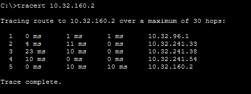

---

## Laporan Resmi (Tahap 2 - DHCP, NAT, dan Tunnel GRE)

### 4. Konfigurasi Layanan DHCP

Sesuai spesifikasi, seluruh interface router dan server menggunakan pengalamatan statis, sedangkan perangkat pengguna di setiap LAN memperoleh konfigurasi IP, subnet mask, default gateway, dan DNS server (`10.32.239.2`) secara dinamis.

#### 4.1 DHCP Relay untuk Subnet CCTV Kota

Khusus subnet CCTV Kota (`10.32.96.0/19`), alamat IP tidak dilayani oleh router `R-DC`, melainkan dialokasikan oleh server DHCP terpusat di LAN Server dan Storage DC (`Server-DC`, IP `10.32.239.2`).

1. **Konfigurasi IP Helper di R-DC:**
   ```
   R-DC(config)# interface GigabitEthernet0/1
   R-DC(config-if)# ip helper-address 10.32.239.2
   R-DC(config-if)# exit
   ```
2. **Konfigurasi DHCP Pool pada Server-DC:**
   - Pool Name: `serverPool`
   - Network Address: `10.32.96.0`
   - Subnet Mask: `255.255.224.0`
   - Default Gateway: `10.32.96.1`
   - DNS Server: `10.32.239.2`
   - Start IP: `10.32.96.2`

#### 4.2 Pool DHCP pada Router Wilayah

Pada masing-masing router wilayah lain, pool DHCP diaktifkan untuk melayani LAN pengguna:

- **R-UTARA**:
  - `POOL-WIFI-UTARA`: `10.32.0.0/18`, gateway `10.32.0.1`, DNS `10.32.239.2`
  - `POOL-SENSOR-UTARA`: `10.32.236.0/23`, gateway `10.32.236.1`, DNS `10.32.239.2`
- **R-SELATAN**:
  - `POOL-WIFI-SELATAN`: `10.32.64.0/19`, gateway `10.32.64.1`, DNS `10.32.239.2`
  - `POOL-PJU-SELATAN`: `10.32.240.128/25`, gateway `10.32.240.129`, DNS `10.32.239.2`
- **R-TIMUR**:
  - `POOL-WIFI-TIMUR`: `10.32.128.0/19`, gateway `10.32.128.1`, DNS `10.32.239.2`
  - `POOL-SENSOR-TIMUR`: `10.32.232.0/22`, gateway `10.32.232.1`, DNS `10.32.239.2`
- **R-BARAT**:
  - `POOL-WIFI-BARAT`: `10.32.192.0/19`, gateway `10.32.192.1`, DNS `10.32.239.2`
  - `POOL-PUSKESMAS-BARAT`: `10.32.238.0/24`, gateway `10.32.238.1`, DNS `10.32.239.2`
- **R-PELABUHAN**:
  - `POOL-SCADA-PELABUHAN`: `10.32.160.0/19`, gateway `10.32.160.1`, DNS `10.32.239.2`
  - `POOL-KANTOR-PELABUHAN`: `10.32.240.0/25`, gateway `10.32.240.1`, DNS `10.32.239.2`
- **R-PUSAT**:
  - `POOL-PEGAWAI-BALAIKOTA`: `10.32.224.0/21`, gateway `10.32.224.1`, DNS `10.32.239.2`

---

### 5. Konfigurasi Network Address Translation (NAT)

Untuk mengamankan jaringan internal dan memungkinkan akses ke internet publik (`Server 8.8.8.8` di balik `R-ISP`), mekanisme **Port Address Translation (PAT / NAT Overload)** diterapkan pada `R-PUSAT`. Sesuai aturan soal, `R-ISP` sama sekali tidak memiliki rute ke blok IP privat internal (`10.32.0.0/16`).

#### 5.1 Konfigurasi NAT Overload pada R-PUSAT

```
R-PUSAT(config)# access-list 1 permit 10.32.0.0 0.0.255.255
R-PUSAT(config)# access-list 1 permit 192.168.4.0 0.0.0.3
R-PUSAT(config)# ip nat inside source list 1 interface GigabitEthernet0/1 overload

R-PUSAT(config)# interface GigabitEthernet0/1
R-PUSAT(config-if)# ip nat outside
R-PUSAT(config-if)# exit

R-PUSAT(config)# interface range GigabitEthernet0/0.10, GigabitEthernet0/0.20, GigabitEthernet0/0.30, GigabitEthernet0/0.40, GigabitEthernet0/0.50, GigabitEthernet0/0.60, GigabitEthernet0/0.70
R-PUSAT(config-if-range)# ip nat inside
R-PUSAT(config-if-range)# exit
```

#### 5.2 Pengujian NAT

Pengujian ping dari host internal (`PC12` di Balai Kota, `PC0` di CCTV DC, dan `PC11` di Pelabuhan) ke `8.8.8.8` berhasil dengan 0% loss. Perintah `show ip nat translations` di `R-PUSAT` mengonfirmasi translasi IP privat ke IP publik `203.0.113.17`.

---

### 6. Konfigurasi Tunnel GRE (Generic Routing Encapsulation)

Tunnel GRE dibangun secara _point-to-point_ antara `R-PUSAT` dan `R-PELABUHAN` menggunakan blok pengalamatan `192.168.4.0/30` ($K=4$). Seluruh lalu lintas antar-subnet Balai Kota dan Pelabuhan diarahkan melewati tunnel ini.

#### 6.1 Konfigurasi Tunnel Interface

1. **R-PUSAT:**

   ```
   R-PUSAT(config)# interface Tunnel0
   R-PUSAT(config-if)# ip address 192.168.4.1 255.255.255.252
   R-PUSAT(config-if)# tunnel source GigabitEthernet0/0.20
   R-PUSAT(config-if)# tunnel destination 10.32.241.54
   R-PUSAT(config-if)# exit
   R-PUSAT(config)# ip route 10.32.160.0 255.255.224.0 192.168.4.2
   R-PUSAT(config)# ip route 10.32.240.0 255.255.255.128 192.168.4.2
   ```

2. **R-PELABUHAN:**
   ```
   R-PELABUHAN(config)# interface Tunnel0
   R-PELABUHAN(config-if)# ip address 192.168.4.2 255.255.255.252
   R-PELABUHAN(config-if)# tunnel source GigabitEthernet0/0
   R-PELABUHAN(config-if)# tunnel destination 10.32.241.37
   R-PELABUHAN(config-if)# exit
   R-PELABUHAN(config)# ip route 10.32.224.0 255.255.248.0 192.168.4.1
   R-PELABUHAN(config)# ip route 10.32.241.0 255.255.255.224 192.168.4.1
   ```

#### 6.2 Verifikasi Jalur Tunnel (Traceroute)

Hasil pelacakan rute (`tracert 10.32.240.2`) dari `PC12` (Balai Kota) ke `PC11` (Kantor Pelabuhan):

```
Tracing route to 10.32.240.2 over a maximum of 30 hops:

  1   0 ms      0 ms      0 ms      10.32.224.1 (R-PUSAT)
  2   0 ms      1 ms      0 ms      192.168.4.2 (Tunnel0 R-PELABUHAN)
  3   0 ms      0 ms      0 ms      10.32.240.2 (PC11 Kantor Pelabuhan)

Trace complete.
```

Hop lompatan melewati `192.168.4.2` membuktikan bahwa paket dienkapsulasi GRE langsung ke Pelabuhan tanpa melalui hop routing IP `R-UTARA`.

#### 6.3 Analisis & Pertimbangan Teknis

1. **Alasan Pemilihan Jalur Tunnel oleh Router:**
   Router memilih jalur tunnel karena tabel routing memiliki entri _static route_ spesifik (`10.32.160.0/19` dan `10.32.240.0/25`) yang menunjuk ke _next-hop_ `192.168.4.2` (`Tunnel0`). Berdasarkan prinsip _Longest Prefix Match_ dan prioritas entri rute spesifik, rute melalui interface tunnel mengesampingkan rute default maupun rute umum lainnya.
2. **Mengapa GRE Saja Tidak Mengenkrpsi Data:**
   Protokol GRE (IP Protocol 47) dirancang sebagai mekanisme enkapsulasi paket untuk membawa protokol layer 3 lain di atas jaringan IP. GRE hanya menambahkan header GRE (4 byte) dan IP header baru di luar paket asli tanpa menyertakan mekanisme kriptografi (tidak ada hashing integritas pesan, pertukaran kunci rahasia, maupun cipher enkripsi simetris seperti AES). Akibatnya, payload di dalam paket GRE tetap berupa _plaintext_ dan dapat dibaca dengan sniffer jaringan. Untuk mengamankan data, GRE memerlukan protokol keamanan tambahan seperti IPsec (_GRE over IPsec_).

   ## 7. Verifikasi dan Finalisasi Perhitungan CIDR

### 7.1 Pemeriksaan Skema Pengalamatan

Verifikasi dilakukan terhadap spreadsheet perhitungan VLSM dan CIDR Kelompok 4. Perhitungan menggunakan nomor kelompok (K = 4), sehingga nilai oktet kedua untuk blok privat diperoleh dari `8 × 4 = 32`.

Terdapat dua rancangan pengalamatan yang perlu dibedakan. VLSM digunakan sebagai skema pengalamatan pada topologi utama Cisco Packet Tracer, sedangkan CIDR digunakan untuk menggabungkan beberapa blok jaringan menjadi blok yang lebih besar (_supernetting_) untuk kebutuhan agregasi rute.

| Metode | Blok induk     | Kegunaan                                                                                                            |
| ------ | -------------- | ------------------------------------------------------------------------------------------------------------------- |
| VLSM   | `10.32.0.0/16` | Skema alamat yang digunakan pada topologi utama dan konfigurasi router.                                             |
| CIDR   | `10.32.0.0/14` | Hasil agregasi beberapa blok jaringan berdasarkan kelompok router. Bukan pengganti alamat VLSM pada topologi utama. |

Sheet VLSM dan CIDR memuat 20 subnet, terdiri atas 14 LAN dan 6 link _point-to-point_. Berdasarkan rekap spreadsheet, jumlah kebutuhan host adalah 42.092 host dan total kebutuhan alamat setelah memperhitungkan alamat network, broadcast, gateway LAN, serta endpoint link adalah 42.146 alamat.

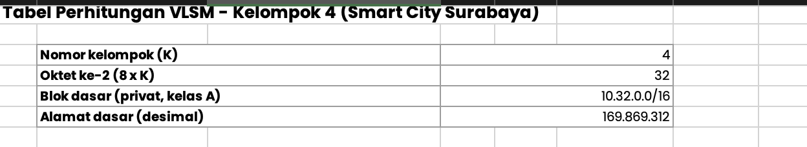

### 7.2 Hasil Verifikasi VLSM

Pemeriksaan VLSM dilakukan terhadap kebutuhan host, ukuran blok, prefix, subnet mask, Network ID, rentang host yang dapat digunakan, alamat broadcast, dan kemungkinan tumpang tindih (_overlap_) antar-subnet.

Berdasarkan rekap pemeriksaan yang tercantum pada spreadsheet revisi, 20 subnet memiliki ukuran blok yang mencukupi kebutuhan masing-masing. Network ID berada pada batas blok yang sesuai, rentang host dan alamat broadcast konsisten, serta tidak ditemukan subnet yang saling tumpang tindih.

| Parameter pemeriksaan               |                                        Hasil rekap |
| ----------------------------------- | -------------------------------------------------: |
| Jumlah subnet                       |                      20 subnet (14 LAN dan 6 link) |
| Total kebutuhan host                |                                             42.092 |
| Total kebutuhan alamat              |                                             42.146 |
| Total ukuran blok subnet individual |                                      61.752 alamat |
| Subnet overlap                      | Tidak ditemukan pada hasil pemeriksaan spreadsheet |

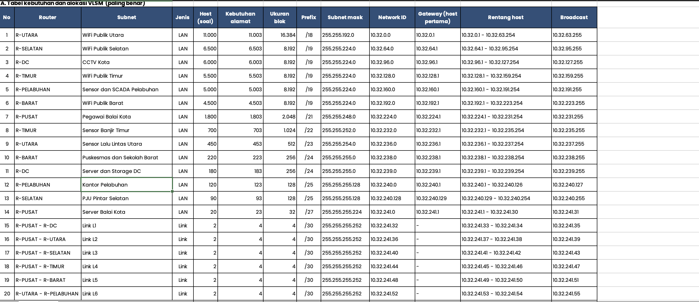

### 7.3 Hasil Penggabungan CIDR per-Router

Penggabungan CIDR dilakukan dengan mengelompokkan subnet berdasarkan router yang melayaninya. Hasil pohon _supernetting_ pada rekap spreadsheet adalah sebagai berikut.

| Node / kelompok       | Kebutuhan alamat | Ukuran blok | Prefix | Blok CIDR        |
| --------------------- | ---------------: | ----------: | -----: | ---------------- |
| R-UTARA (lokal)       |           16.900 |      32.768 |  `/17` | `10.32.0.0/17`   |
| R-PELABUHAN           |            8.324 |      16.384 |  `/18` | `10.32.128.0/18` |
| R-DC                  |            8.452 |      16.384 |  `/18` | `10.33.0.0/18`   |
| R-BARAT               |            8.452 |      16.384 |  `/18` | `10.33.64.0/18`  |
| R-SELATAN             |            8.324 |      16.384 |  `/18` | `10.33.128.0/18` |
| R-TIMUR               |            9.220 |      16.384 |  `/18` | `10.33.192.0/18` |
| R-PUSAT (LAN lokal)   |            2.080 |       4.096 |  `/20` | `10.34.0.0/20`   |
| R-UTARA + R-PELABUHAN |           49.152 |      65.536 |  `/16` | `10.32.0.0/16`   |
| R-PUSAT (root)        |          135.168 |     262.144 |  `/14` | `10.32.0.0/14`   |

Blok gabungan akhir atau _root CIDR_ adalah `10.32.0.0/14`, dengan rentang alamat `10.32.0.0` sampai `10.35.255.255`. Ukuran blok root tersebut adalah 262.144 alamat. Angka tersebut merupakan ukuran blok agregasi, bukan jumlah alamat yang digunakan oleh seluruh host.

assets/07-03-pohon-cidr.png

### 7.4 Kesimpulan Audit Spreadsheet

| Parameter                                           |                                              Hasil |
| --------------------------------------------------- | -------------------------------------------------: |
| Jumlah subnet                                       |                      20 subnet (14 LAN dan 6 link) |
| Total host sesuai soal                              |                                             42.092 |
| Total kebutuhan alamat                              |                                             42.146 |
| Total ukuran blok subnet individual                 |                                      61.752 alamat |
| Ukuran blok induk VLSM                              |                              65.536 alamat (`/16`) |
| Ukuran blok root CIDR                               |                             262.144 alamat (`/14`) |
| Efisiensi kebutuhan alamat terhadap blok induk VLSM |                                             64,31% |
| Efisiensi kebutuhan alamat terhadap root CIDR       |                                             16,08% |
| Subnet overlap                                      | Tidak ditemukan pada hasil pemeriksaan spreadsheet |

Dengan demikian, blok VLSM `10.32.0.0/16` tetap menjadi acuan pengalamatan pada topologi utama Cisco Packet Tracer. Hasil CIDR `10.32.0.0/14` merupakan rancangan agregasi yang terpisah. Kedua hasil tersebut memiliki fungsi berbeda dan tidak boleh dicampur sebagai satu skema pengalamatan pada konfigurasi perangkat.

---

## 8. Konfigurasi Layanan Server Aplikasi

### 8.1 Identitas dan Pengalamatan Server

Layanan aplikasi ditempatkan pada **Server-DC** di jaringan Server dan Storage Data Center (R-DC). Pengalamatan server menggunakan konfigurasi statis berikut.

| Parameter       | Nilai            |
| --------------- | ---------------- |
| Nama perangkat  | Server-DC        |
| Network         | `10.32.239.0/24` |
| IP Address      | `10.32.239.2`    |
| Subnet Mask     | `255.255.255.0`  |
| Default Gateway | `10.32.239.1`    |
| DNS Server      | `10.32.239.2`    |

assets/08-01-ip-server-dc.png

### 8.2 Konfigurasi dan Pengujian DNS

DNS (_Domain Name System_) menerjemahkan nama domain menjadi alamat IP sehingga klien dapat mengakses layanan menggunakan nama host atau domain.

**Langkah konfigurasi pada Server-DC:**

1. Klik **Server-DC** → tab **Services** → **DNS**.
2. Ubah layanan DNS menjadi **On**.
3. Pada bagian penambahan record, isi **Name** dengan nama domain yang benar-benar digunakan pada simulasi.
4. Pilih tipe record **A Record**.
5. Isi **Address** dengan `10.32.239.2`, kemudian klik **Add**.
6. Pastikan record muncul pada daftar DNS.

| Jenis record | Nama                          | Alamat tujuan |
| ------------ | ----------------------------- | ------------- |
| A Record     | `[domain DNS yang digunakan]` | `10.32.239.2` |

**Pengujian dari PC klien:**

1. Pilih salah satu PC klien yang sudah memperoleh DNS Server `10.32.239.2`.
2. Buka **Desktop** → **Command Prompt**.
3. Jalankan perintah berikut. Ganti teks dalam tanda kurung siku dengan domain yang dibuat pada DNS Server.

```text
ping [domain DNS yang digunakan]
```

Jika DNS berfungsi, baris awal hasil ping akan menampilkan nama domain yang diarahkan ke alamat `10.32.239.2`. Pastikan juga PC klien menggunakan DNS Server `10.32.239.2` pada **Desktop → IP Configuration**.

assets/08-02a-dns-server.png

assets/08-02b-dns-client.png

### 8.3 Konfigurasi dan Pengujian Web Smart City

Layanan Web Smart City menyediakan halaman informasi berbasis web yang dapat diakses oleh PC klien melalui browser.

**Langkah konfigurasi pada Server-DC:**

1. Klik **Server-DC** → tab **Services** → **HTTP**.
2. Pastikan layanan **HTTP** dalam keadaan **On**. Aktifkan HTTPS hanya jika memang digunakan pada simulasi.
3. Jika halaman web menggunakan halaman bawaan, pastikan file `index.html` tersedia. Jika halaman telah diedit, simpan perubahan tersebut.

**Pengujian dari PC klien:**

1. Pilih PC klien yang terhubung ke jaringan.
2. Buka **Desktop** → **Web Browser**.
3. Masukkan URL menggunakan domain DNS yang sudah dibuat, misalnya `http://[domain DNS yang digunakan]`.
4. Tekan **Go** dan pastikan halaman Web Smart City tampil.


### 8.4 Konfigurasi dan Pengujian FTP CCTV

FTP (_File Transfer Protocol_) digunakan untuk mengunggah dan mengunduh berkas pada server. Pada simulasi ini, FTP digunakan untuk kebutuhan transfer berkas CCTV.

**Langkah konfigurasi pada Server-DC:**

1. Klik **Server-DC** → tab **Services** → **FTP**.
2. Ubah layanan FTP menjadi **On**.
3. Tambahkan akun pengguna FTP sesuai akun yang digunakan kelompok.
4. Atur hak akses sesuai kebutuhan pengujian, terutama **Read**, **Write**, dan **List** agar pengguna dapat melihat serta mengunggah berkas.
5. Klik **Add** atau simpan akun sesuai tampilan Packet Tracer.

**Pengujian upload dari PC klien:**

1. Pada PC klien, buka **Desktop** → **Command Prompt**.
2. Jalankan perintah koneksi berikut:

```text
ftp 10.32.239.2
```

3. Ketika diminta, masukkan username dan password FTP yang dibuat pada Server-DC.
4. Setelah berhasil masuk, jalankan perintah berikut satu per satu:

```text
dir
put cctv_test.txt
dir
bye
```

`cctv_test.txt` harus sudah tersedia pada PC klien. Jika belum ada, buat file teks melalui **Desktop → Text Editor**, isi teks uji sederhana, lalu simpan dengan nama `cctv_test.txt` sebelum menjalankan perintah FTP. Perintah `put` digunakan untuk mengunggah file dari PC klien ke server. Perintah `dir` setelah upload digunakan untuk memeriksa apakah file sudah tercatat pada direktori FTP.

assets/09-02d-config ftp.png

assets/08-02e-berhasil ftp nya.png

### 8.5 Konfigurasi dan Pengujian Email

Layanan Email memungkinkan pengguna jaringan mengirim dan menerima pesan elektronik melalui protokol SMTP dan POP3.

**Langkah konfigurasi pada Server-DC:**

1. Klik **Server-DC** → tab **Services** → **EMAIL**.
2. Aktifkan layanan **SMTP** dan **POP3**.
3. Isi domain email sesuai domain yang dipakai pada simulasi, kemudian klik **Set**.
4. Tambahkan akun pengguna beserta password-nya.
5. Pastikan akun pengirim dan penerima sudah terdaftar pada server.

**Catatan akun:** pada percobaan sebelumnya, alamat `pegawai@gmail.com` digunakan sebagai alamat pegawai. Jika alamat tersebut tetap menjadi akun final, domain pada server harus `gmail.com` dan username yang dimasukkan pada daftar akun server adalah `pegawai` (tanpa `@gmail.com`). Pada konfigurasi Email di PC, gunakan alamat lengkap `pegawai@gmail.com`.

**Langkah konfigurasi Email pada PC klien:**

1. Klik PC pengirim → **Desktop** → **Email**.
2. Isi Display Name, alamat email lengkap, Incoming Mail Server, Outgoing Mail Server, username, dan password.
3. Untuk server masuk dan keluar, gunakan alamat Server-DC `10.32.239.2` jika layanan SMTP/POP3 memang berjalan pada Server-DC.
4. Username diisi sesuai username akun pada server, bukan alamat email lengkap.
5. Lakukan konfigurasi yang sama pada PC penerima menggunakan akun penerima yang terdaftar.

**Pengujian kirim dan terima:**

1. Dari PC pengirim, buat email baru.
2. Isi alamat penerima dengan alamat email lengkap yang sudah dibuat pada Server-DC.
3. Isi subject dan pesan uji, kemudian klik **Send**.
4. Pindah ke PC penerima dan klik **Receive**.
5. Pastikan pesan muncul pada Inbox penerima.

**Cara mengambil screenshot:**

- Screenshot pertama: Server-DC → Services → EMAIL, SMTP/POP3 aktif, domain, dan daftar akun terlihat.
- Screenshot kedua: PC pengirim yang menunjukkan email berhasil dikirim atau berada pada daftar pesan terkirim.
- Screenshot ketiga: PC penerima setelah menekan **Receive**, dengan pesan uji terlihat pada Inbox.


assets/berhasil menerima email.png

### 8.6 Rekapitulasi Layanan Aplikasi

| Layanan        | Fungsi                                       | Status pekerjaan                                                                      |
| -------------- | -------------------------------------------- | ------------------------------------------------------------------------------------- |
| DNS            | Menerjemahkan nama domain menjadi alamat IP. | Sudah dikonfigurasi; lampirkan bukti record dan pengujian resolusi nama.              |
| Web Smart City | Menyediakan halaman informasi berbasis web.  | Sudah dikonfigurasi; lampirkan bukti akses dari browser klien.                        |
| FTP CCTV       | Mengunggah dan mengunduh berkas CCTV.        | Pengujian upload telah dilaporkan berhasil; lampirkan bukti `put` dan daftar file.    |
| Email          | Mengirim dan menerima pesan elektronik.      | Pengujian kirim dan terima telah dilaporkan berhasil; lampirkan bukti Sent dan Inbox. |

---

## 9. Dynamic Routing OSPF dan Pengujian Failover

### 9.1 Tujuan dan File Simulasi

Konfigurasi OSPF dibuat pada file salinan khusus agar file utama yang menggunakan _static routing_ tetap terjaga. Karena topologi utama menggunakan blok VLSM `10.32.0.0/16`, file salinan OSPF menggunakan nama:

`K4_VLSM_OSPF.pkt`

OSPF (_Open Shortest Path First_) memungkinkan router bertukar informasi rute secara dinamis. Saat jalur yang sedang digunakan mengalami gangguan, router dapat memilih jalur alternatif berdasarkan informasi routing dan nilai cost.

**Penting:** jangan melakukan pengujian `shutdown` pada file utama. Lakukan seluruh perubahan dan pengujian pada `K4_VLSM_OSPF.pkt`.

### 9.2 Topologi dan Jalur yang Diverifikasi

Informasi link yang tercatat pada topologi utama adalah sebagai berikut.

| Link                   | Perangkat/interface   | Alamat IP                                          | Network           |
| ---------------------- | --------------------- | -------------------------------------------------- | ----------------- |
| L2                     | R-PUSAT ↔ R-UTARA     | R-PUSAT `10.32.241.37`; R-UTARA `10.32.241.38`     | `10.32.241.36/30` |
| L6 pada topologi utama | R-UTARA ↔ R-PELABUHAN | R-UTARA `10.32.241.53`; R-PELABUHAN `10.32.241.54` | `10.32.241.52/30` |
| GRE Tunnel0            | R-PUSAT ↔ R-PELABUHAN | R-PUSAT `192.168.4.1`; R-PELABUHAN `192.168.4.2`   | `192.168.4.0/30`  |

GRE Tunnel0 menggunakan sumber jaringan R-PUSAT `10.32.241.37` dan tujuan `10.32.241.54`. Pada pengujian OSPF, R-PUSAT pernah menampilkan neighbor R-PELABUHAN melalui `192.168.4.2` pada interface Tunnel0, serta neighbor R-UTARA melalui `10.32.241.38`.

**Catatan penamaan L6/L7:** pada tabel topologi utama, alamat `10.32.241.53` dan `10.32.241.54` pada network `10.32.241.52/30` tercatat sebagai L6. Karena itu, alamat tersebut tidak boleh otomatis ditulis sebagai L7. Hasil pengujian yang sudah tercatat membuktikan perpindahan rute dari Tunnel0 ke jalur melalui R-UTARA (`10.32.241.38`). Jika diagram file OSPF memberi nama L7 pada jalur alternatif tersebut, samakan label dokumentasi dengan diagram final. Jika ada link fisik L7 tambahan yang berbeda, lengkapi alamat dan interface-nya dari hasil pemeriksaan Packet Tracer.

**Perintah untuk memeriksa interface dan tetangga link:** jalankan pada CLI R-PUSAT, R-UTARA, dan R-PELABUHAN. Gunakan hasilnya untuk memastikan nama interface dan router yang benar-benar terhubung. Jangan menebak nama port atau alamat L7.

```text
enable
show ip interface brief
show cdp neighbors
show cdp neighbors detail
```

assets/topologi ospf.png


### 9.3 Konfigurasi dan Verifikasi OSPF

Parameter OSPF yang digunakan pada simulasi adalah:

| Parameter                             | Nilai |
| ------------------------------------- | ----- |
| Routing protocol                      | OSPF  |
| Process ID                            | `1`   |
| Area                                  | `0`   |
| Cost interface yang pernah dilaporkan | `1`   |

**Contoh konfigurasi pada router internal:** jalankan pada CLI setiap router internal yang ikut dalam OSPF, yaitu R-PUSAT, R-DC, R-UTARA, R-PELABUHAN, R-BARAT, R-TIMUR, dan R-SELATAN. Perintah `network` berikut mengaktifkan OSPF pada interface yang alamatnya berada di blok `10.32.0.0/16`.

```text
enable
configure terminal
router ospf 1
network 10.32.0.0 0.0.255.255 area 0
end
write memory
```

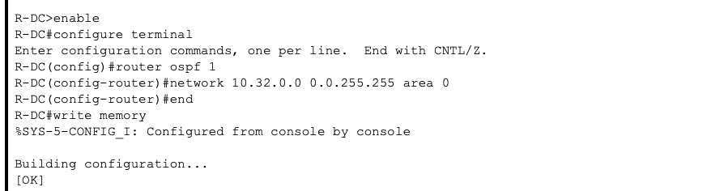

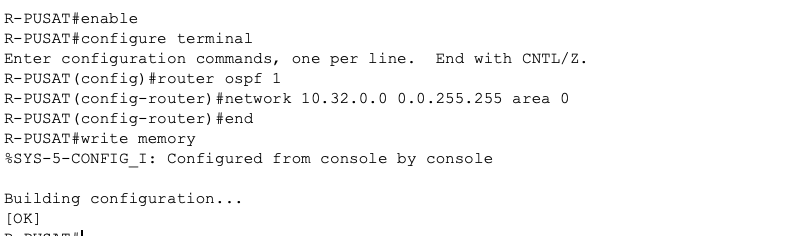

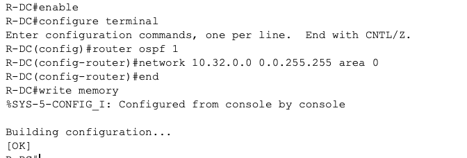

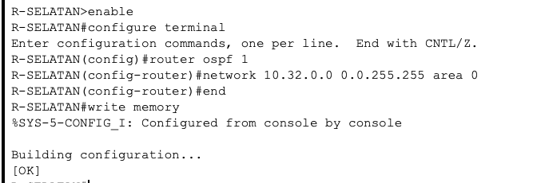

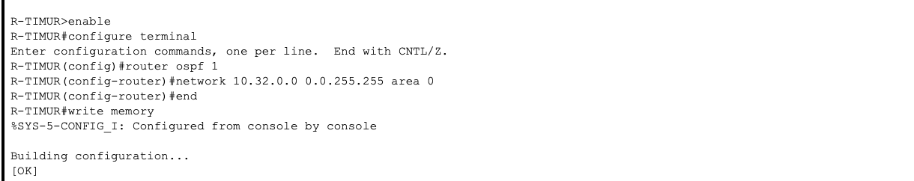

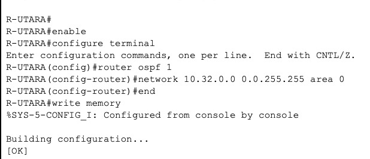

**Tambahan pada R-PUSAT dan R-PELABUHAN:** karena Tunnel0 menggunakan jaringan `192.168.4.0/30`, tambahkan network statement berikut pada kedua router tersebut apabila belum ada.

```text
configure terminal
router ospf 1
network 192.168.4.0 0.0.0.3 area 0
end
write memory
```

Jangan mengulang konfigurasi jika network statement tersebut sudah ada. Untuk memastikan OSPF benar-benar digunakan, periksa apakah masih ada _static route_ ke subnet yang sama. Pada file OSPF, rute statis yang memiliki tujuan dan prefix sama dapat lebih diprioritaskan daripada rute OSPF. Periksa terlebih dahulu dengan:

```text
show running-config | include ip route
```

Hapus hanya rute statis internal yang memang masih ada dan menghalangi penggunaan OSPF. Jangan menghapus default route internet jika masih dibutuhkan.

**Perintah verifikasi pada CLI router:**

```text
show ip interface brief
show ip ospf neighbor
show ip route
show ip route ospf
show ip route 10.32.160.0
show ip route 10.32.240.0
```

Keterangan:

- `show ip interface brief` menampilkan status interface dan alamat IP.
- `show ip ospf neighbor` menampilkan router tetangga dan status adjacency. Status **FULL** menunjukkan adjacency telah terbentuk.
- `show ip route ospf` menampilkan rute yang dipelajari melalui OSPF, ditandai kode `O`.
- `show ip route 10.32.160.0` dan `show ip route 10.32.240.0` digunakan untuk memeriksa jalur menuju subnet Pelabuhan.

Pada pengujian sebelumnya, R-PUSAT menampilkan enam neighbor OSPF berstatus **FULL**, termasuk R-PELABUHAN melalui Tunnel0 dan R-UTARA melalui `10.32.241.38`. Screenshot akhir harus diambil dari output terbaru file OSPF yang digunakan.

assets/verif cli r pusat.png

### 9.4 Pengujian Failover

Pengujian dilakukan untuk memastikan komunikasi ke jaringan Pelabuhan tetap memiliki jalur ketika Tunnel0 dinonaktifkan. Pengujian ini dilakukan pada file salinan OSPF.

**Perangkat uji:**

- PC sumber: PC Pegawai Balai Kota, IP `10.32.224.2`.
- PC tujuan: PC SCADA Pelabuhan, IP `10.32.160.2`.
- Router yang diperiksa: R-PUSAT.

**A. Uji kondisi awal**

1. Pastikan Tunnel0 pada R-PUSAT dalam keadaan `up/up`.
2. Pada CLI R-PUSAT, jalankan:

```text
show ip interface brief
show ip ospf neighbor
show ip route 10.32.160.0
show ip route 10.32.240.0
```

3. Pada PC Pegawai Balai Kota, buka **Desktop → Command Prompt**, kemudian jalankan:

```text
ping 10.32.160.2
```

4. Simpan hasil ping dan tabel routing sebagai kondisi sebelum failover.

**B. Simulasikan gangguan pada Tunnel0**

Pada CLI R-PUSAT, jalankan perintah berikut:

```text
enable
configure terminal
interface Tunnel0
shutdown
end
```

Tunggu proses konvergensi OSPF, kemudian periksa perubahan rute:

```text
show ip interface brief
show ip ospf neighbor
show ip route 10.32.160.0
show ip route 10.32.240.0
show ip route ospf
```

Hasil yang pernah tercatat setelah Tunnel0 dinonaktifkan adalah rute menuju `10.32.160.0/19` dan `10.32.240.0/25` berubah menjadi rute OSPF melalui next-hop `10.32.241.38` dengan metric `3`. Next-hop tersebut merupakan R-UTARA pada link L2. Hal ini menunjukkan bahwa rute alternatif melalui R-UTARA dipilih setelah Tunnel0 tidak tersedia.

**C. Uji konektivitas setelah failover**

Pada PC Pegawai Balai Kota, jalankan kembali:

```text
ping 10.32.160.2
```


**D. Pulihkan Tunnel0**

Setelah pengujian selesai, aktifkan kembali Tunnel0 pada R-PUSAT:

```text
enable
configure terminal
interface Tunnel0
no shutdown
end
```

Kemudian verifikasi:

```text
show ip interface brief
show ip ospf neighbor
show ip route 10.32.160.0
show ip route 10.32.240.0
```

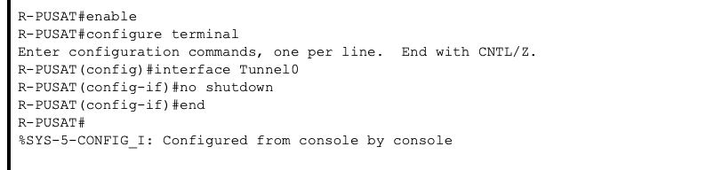

Untuk menguji konektivitas tunnel setelah dipulihkan, dari CLI R-PELABUHAN jalankan:

```text
ping 192.168.4.1
```


Pada pengujian sebelumnya, Tunnel0 kembali berstatus `up/up` dan neighbor R-PELABUHAN kembali **FULL**. Ping dari R-PELABUHAN ke `192.168.4.1` juga pernah dilaporkan berhasil 5/5. Namun, tabel routing masih menunjukkan jalur melalui `10.32.241.38` dengan metric `3`, bukan melalui GRE Tunnel0. Oleh karena itu, status pulihnya interface, neighbor, dan konektivitas alamat tunnel sudah tercatat, tetapi perpindahan rute kembali ke Tunnel0 (_failback_) belum dapat dinyatakan berhasil sebelum tabel routing menunjukkan jalur tersebut.

### 9.5 Analisis Hasil OSPF dan Failover

Hasil verifikasi menunjukkan bahwa OSPF telah membentuk adjacency antara R-PUSAT dan router-router internal. Pada pengujian gangguan, Tunnel0 dinonaktifkan melalui perintah `shutdown`. Setelah proses konvergensi, rute menuju subnet Pelabuhan berubah ke next-hop `10.32.241.38` dengan metric `3`, yaitu jalur melalui R-UTARA. Perubahan rute tersebut membuktikan bahwa OSPF dapat memilih jalur alternatif ketika jalur Tunnel0 tidak tersedia.

Terdapat dua hal yang harus dibedakan dalam pelaporan:

1. **Failover:** perpindahan rute dari Tunnel0 ke jalur melalui R-UTARA setelah Tunnel0 dinonaktifkan telah tercatat pada output `show ip route`.
2. **Failback:** setelah Tunnel0 diaktifkan kembali, neighbor kembali FULL, tetapi rute yang tercatat masih melalui `10.32.241.38`. Karena itu, perpindahan rute kembali ke Tunnel0 belum terbukti pada pengujian tersebut.

Untuk penamaan link, tabel topologi utama mencatat koneksi R-UTARA `10.32.241.53` ke R-PELABUHAN `10.32.241.54` sebagai L6. Jalur alternatif yang terlihat pada tabel routing menggunakan next-hop R-UTARA `10.32.241.38`. Gunakan label L7 hanya jika label tersebut memang sesuai dengan diagram dan file OSPF final kelompok.

---

## 10. Kesimpulan Pekerjaan Anggota 3

Pekerjaan Anggota 3 mencakup verifikasi dan finalisasi perhitungan CIDR, konfigurasi layanan aplikasi pada Server-DC, serta konfigurasi dan pengujian _dynamic routing_ OSPF pada file salinan.

Pada bagian pengalamatan, blok VLSM `10.32.0.0/16` tetap digunakan sebagai acuan topologi utama, sedangkan root CIDR `10.32.0.0/14` merupakan hasil agregasi subnet. Rekap spreadsheet mencakup 20 subnet yang terdiri atas 14 LAN dan 6 link _point-to-point_. Hasil pemeriksaan spreadsheet yang tercatat menunjukkan tidak ditemukan subnet yang saling tumpang tindih.

Pada bagian server aplikasi, Server-DC menggunakan alamat `10.32.239.2/24` dengan gateway `10.32.239.1`. Layanan yang ditangani meliputi DNS, Web Smart City, FTP CCTV, dan Email. DNS dan Web Smart City telah dikonfigurasi. Pengujian upload FTP serta pengiriman dan penerimaan Email telah dilaporkan berhasil. Bukti konfigurasi dan hasil pengujian dilampirkan pada bagian 8.

Pada bagian routing, OSPF menggunakan process ID `1` dan area `0`. Neighbor OSPF pada R-PUSAT pernah tercatat berstatus **FULL**. Ketika Tunnel0 dinonaktifkan, rute menuju subnet Pelabuhan berpindah melalui next-hop `10.32.241.38` dengan metric `3`. Hasil ini menunjukkan failover ke jalur alternatif melalui R-UTARA. Setelah Tunnel0 diaktifkan kembali, interface dan neighbor kembali aktif, tetapi rute belum berpindah kembali ke Tunnel0 pada pengujian yang tercatat. Oleh sebab itu, hasil failback tidak dinyatakan berhasil sebelum dibuktikan oleh tabel routing.

Dengan dokumentasi tersebut, pekerjaan Anggota 3 memiliki uraian konfigurasi, perintah verifikasi, prosedur pengujian, serta tempat lampiran screenshot untuk setiap layanan dan proses failover.

---
