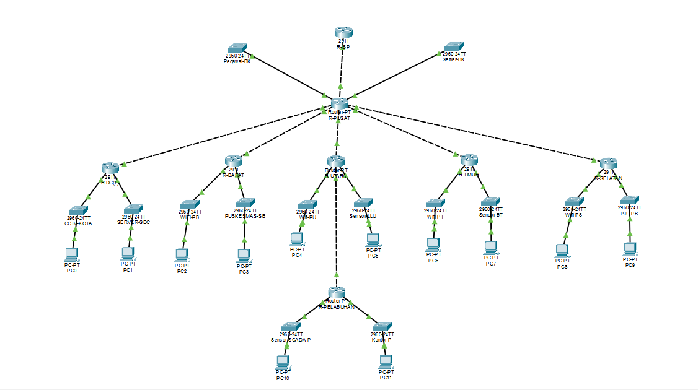

# MidProject-Jarkom-K4

**Kelompok** : K-4

**Anggota** :

| Nama                 | NRP        |
| -------------------- | ---------- |
| Putri Permata Sabila | 5027251047 |

## Daftar Isi

1. [Topologi dan Pengalamatan IP](#1-topologi-dan-pengalamatan-ip)
2. [Konfigurasi Routing Statis (Static Routing)](#2-konfigurasi-routing-statis-static-routing)
3. [Pengujian Konektivitas (Ping dan Tracert)](#3-pengujian-konektivitas-ping-dan-tracert)

---

## Laporan Resmi (Tahap 1 - Infrastruktur dan Routing Statis)

### 1. Topologi dan Pengalamatan IP

#### 1.1 Rancangan Topologi

Fase pertama membangun topologi jaringan Smart City Surabaya pada Cisco Packet Tracer. Topologi terdiri dari 7 _router_ wilayah (R-PUSAT, R-DC, R-UTARA, R-PELABUHAN, R-BARAT, R-TIMUR, R-SELATAN) dan 1 _router_ penyedia internet (R-ISP). R-PUSAT menjadi titik transit yang terhubung langsung ke R-DC, R-UTARA, R-SELATAN, R-TIMUR, dan R-BARAT. R-PELABUHAN terhubung ke R-UTARA melalui link L6.

Pengalamatan IP menggunakan skema _Variable Length Subnet Mask_ (VLSM) pada blok privat `10.32.0.0/16` agar penggunaan alamat lebih efisien.

**Perangkat yang digunakan:**

| Perangkat  | Jumlah | Model                                 | Keterangan                                                                                                        |
| ---------- | :----: | ------------------------------------- | ----------------------------------------------------------------------------------------------------------------- |
| Router     |   8    | PT-Router + modul `PT-ROUTER-NM-1CGE` | 7 router wilayah dan R-ISP. Semua antarmuka GigabitEthernet agar kapasitas _backbone_ realistis untuk skala kota. |
| Switch     |   14   | Cisco 2960                            | Satu switch untuk setiap LAN.                                                                                     |
| End Device |   14   | PC / Server                           | Satu perwakilan untuk setiap LAN.                                                                                 |

**Jenis kabel yang digunakan:**

| Koneksi                       | Jenis Kabel             |
| ----------------------------- | ----------------------- |
| Router ke Switch              | Copper Straight-Through |
| Switch ke PC / Server         | Copper Straight-Through |
| Router ke Router (_backbone_) | Copper Cross-Over       |

**Link point-to-point (/30):**

| Link | Router A | IP Router A    | Router B    | IP Router B    | Network           |
| ---- | -------- | -------------- | ----------- | -------------- | ----------------- |
| L1   | R-PUSAT  | `10.32.241.33` | R-DC        | `10.32.241.34` | `10.32.241.32/30` |
| L2   | R-PUSAT  | `10.32.241.37` | R-UTARA     | `10.32.241.38` | `10.32.241.36/30` |
| L3   | R-PUSAT  | `10.32.241.41` | R-SELATAN   | `10.32.241.42` | `10.32.241.40/30` |
| L4   | R-PUSAT  | `10.32.241.45` | R-TIMUR     | `10.32.241.46` | `10.32.241.44/30` |
| L5   | R-PUSAT  | `10.32.241.49` | R-BARAT     | `10.32.241.50` | `10.32.241.48/30` |
| L6   | R-UTARA  | `10.32.241.53` | R-PELABUHAN | `10.32.241.54` | `10.32.241.52/30` |
| ISP  | R-PUSAT  | `203.0.113.14` | R-ISP       | `203.0.113.13` | `203.0.113.12/30` |

**Alasan Pemilihan Skema VLSM:**

Skema VLSM dipilih karena kebutuhan host tiap LAN sangat bervariasi, mulai dari LAN WiFi Publik berukuran `/18` hingga link _point-to-point_ berukuran `/30`. Dengan VLSM, setiap segmen mendapat blok yang sesuai kebutuhan sehingga tidak ada alamat yang terbuang, sedangkan skema berukuran tetap akan memaksa link yang hanya membutuhkan 2 alamat memakai blok sebesar LAN publik. Blok dialokasikan berurutan dari prefix terbesar ke terkecil sehingga tidak ada alamat yang saling tumpang tindih, dan alamat _gateway_ tiap LAN dipetakan pada alamat host pertama.

**Alasan Desain Topologi:**

- R-PUSAT ditempatkan sebagai pusat (_hub_) yang terhubung ke seluruh router wilayah sesuai arsitektur _backbone_ pada soal. Susunan ini menyederhanakan routing statis karena router cabang cukup memakai satu _default route_ ke R-PUSAT.
- R-PELABUHAN terhubung melalui R-UTARA (link L6) sesuai skema pada soal. Karena itu R-UTARA memerlukan rute spesifik ke arah pelabuhan.
- Setiap LAN memakai satu switch dan satu perangkat perwakilan sehingga tiap _subnet_ terpusat pada switch masing-masing, sementara router berperan menghubungkan antar _subnet_.
- Link antar-router memakai prefix `/30` karena hanya membutuhkan dua alamat host.
- Seluruh router memakai antarmuka GigabitEthernet agar kapasitas _backbone_ realistis untuk skala kota, terutama R-PUSAT yang menampung 8 koneksi aktif (2 LAN, 5 link cabang, dan 1 link ISP).

**Output Topologi**



#### 1.2 Konfigurasi IP Antarmuka Router

Setiap jaringan lokal (LAN) memerlukan alamat _gateway_ yang dipasang pada antarmuka (_interface_) _router_ untuk menjembatani komunikasi keluar dari _subnet_ tersebut. Konfigurasi dilakukan melalui CLI karena pengisian IP lewat antarmuka grafis (GUI) membuat Packet Tracer mengubah _subnet mask_ secara otomatis menjadi `255.0.0.0` (kelas A).

Berikut templat dasar yang digunakan pada seluruh _router_:

```
Router> enable
Router# configure terminal
Router(config)# hostname [nama_router]
[nama_router](config)# interface [nama_port_interface]
[nama_router](config-if)# ip address [IP_Gateway] [Subnet_Mask]
[nama_router](config-if)# no shutdown
[nama_router](config-if)# exit
[nama_router](config)# exit
[nama_router]# write memory
```

Perintah `no shutdown` wajib dijalankan pada kedua ujung link agar indikator kabel berubah menjadi hijau. Perangkat akhir (PC) dikonfigurasi manual melalui **Desktop > IP Configuration** dan diarahkan ke _gateway_ router wilayahnya.

#### 1.3 Alokasi IP per Wilayah

##### A. Wilayah Pusat (R-PUSAT)

| LAN                                   | Perangkat             | IP Address    | Subnet Mask       | Default Gateway |
| ------------------------------------- | --------------------- | ------------- | ----------------- | --------------- |
| Pegawai Balai Kota (`10.32.224.0/21`) | Router                | `10.32.224.1` | `255.255.248.0`   | -               |
|                                       | PC Pegawai Balai Kota | `10.32.224.2` | `255.255.248.0`   | `10.32.224.1`   |
| Server Balai Kota (`10.32.241.0/27`)  | Router                | `10.32.241.1` | `255.255.255.224` | -               |
|                                       | PC Server Balai Kota  | `10.32.241.2` | `255.255.255.224` | `10.32.241.1`   |

**Output R-PUSAT**


##### B. Wilayah Data Center (R-DC)

| LAN                                      | Perangkat                | IP Address    | Subnet Mask     | Default Gateway |
| ---------------------------------------- | ------------------------ | ------------- | --------------- | --------------- |
| CCTV Kota (`10.32.96.0/19`)              | Router                   | `10.32.96.1`  | `255.255.224.0` | -               |
|                                          | PC CCTV Kota             | `10.32.96.2`  | `255.255.224.0` | `10.32.96.1`    |
| Server dan Storage DC (`10.32.239.0/24`) | Router                   | `10.32.239.1` | `255.255.255.0` | -               |
|                                          | PC Server dan Storage DC | `10.32.239.2` | `255.255.255.0` | `10.32.239.1`   |

**Output R-DC**


##### C. Wilayah Utara (R-UTARA)

| LAN                                         | Perangkat            | IP Address    | Subnet Mask     | Default Gateway |
| ------------------------------------------- | -------------------- | ------------- | --------------- | --------------- |
| WiFi Publik Utara (`10.32.0.0/18`)          | Router               | `10.32.0.1`   | `255.255.192.0` | -               |
|                                             | PC WiFi Publik Utara | `10.32.0.2`   | `255.255.192.0` | `10.32.0.1`     |
| Sensor Lalu Lintas Utara (`10.32.236.0/23`) | Router               | `10.32.236.1` | `255.255.254.0` | -               |
|                                             | PC Sensor Utara      | `10.32.236.2` | `255.255.254.0` | `10.32.236.1`   |

**Output R-UTARA**


##### D. Wilayah Pelabuhan (R-PELABUHAN)

| LAN                                 | Perangkat           | IP Address    | Subnet Mask       | Default Gateway |
| ----------------------------------- | ------------------- | ------------- | ----------------- | --------------- |
| Sensor dan SCADA (`10.32.160.0/19`) | Router              | `10.32.160.1` | `255.255.224.0`   | -               |
|                                     | PC SCADA            | `10.32.160.2` | `255.255.224.0`   | `10.32.160.1`   |
| Kantor Pelabuhan (`10.32.240.0/25`) | Router              | `10.32.240.1` | `255.255.255.128` | -               |
|                                     | PC Kantor Pelabuhan | `10.32.240.2` | `255.255.255.128` | `10.32.240.1`   |

**Output R-PELABUHAN**


##### E. Wilayah Barat (R-BARAT)

| LAN                                      | Perangkat            | IP Address    | Subnet Mask     | Default Gateway |
| ---------------------------------------- | -------------------- | ------------- | --------------- | --------------- |
| WiFi Publik Barat (`10.32.192.0/19`)     | Router               | `10.32.192.1` | `255.255.224.0` | -               |
|                                          | PC WiFi Publik Barat | `10.32.192.2` | `255.255.224.0` | `10.32.192.1`   |
| Puskesmas dan Sekolah (`10.32.238.0/24`) | Router               | `10.32.238.1` | `255.255.255.0` | -               |
|                                          | PC Puskesmas         | `10.32.238.2` | `255.255.255.0` | `10.32.238.1`   |

**Output R-BARAT**


##### F. Wilayah Timur (R-TIMUR)

| LAN                                    | Perangkat            | IP Address    | Subnet Mask     | Default Gateway |
| -------------------------------------- | -------------------- | ------------- | --------------- | --------------- |
| WiFi Publik Timur (`10.32.128.0/19`)   | Router               | `10.32.128.1` | `255.255.224.0` | -               |
|                                        | PC WiFi Publik Timur | `10.32.128.2` | `255.255.224.0` | `10.32.128.1`   |
| Sensor Banjir Timur (`10.32.232.0/22`) | Router               | `10.32.232.1` | `255.255.252.0` | -               |
|                                        | PC Sensor Timur      | `10.32.232.2` | `255.255.252.0` | `10.32.232.1`   |

**Output R-TIMUR**


##### G. Wilayah Selatan (R-SELATAN)

| LAN                                     | Perangkat              | IP Address      | Subnet Mask       | Default Gateway |
| --------------------------------------- | ---------------------- | --------------- | ----------------- | --------------- |
| WiFi Publik Selatan (`10.32.64.0/19`)   | Router                 | `10.32.64.1`    | `255.255.224.0`   | -               |
|                                         | PC WiFi Publik Selatan | `10.32.64.2`    | `255.255.224.0`   | `10.32.64.1`    |
| PJU Pintar Selatan (`10.32.240.128/25`) | Router                 | `10.32.240.129` | `255.255.255.128` | -               |
|                                         | PC PJU Pintar          | `10.32.240.130` | `255.255.255.128` | `10.32.240.129` |

**Output R-SELATAN**


---

### 2. Konfigurasi Routing Statis (Static Routing)

Agar setiap _subnet_ di wilayah yang berbeda dapat saling bertukar paket data, rute statis diterapkan pada seluruh infrastruktur _backbone_. Seluruh _router_ cabang dikonfigurasi dengan _default route_ (`0.0.0.0 0.0.0.0`) yang mengarah ke R-PUSAT untuk meringkas entri perutean. R-PUSAT bertindak sebagai titik transit pusat dan dikonfigurasi dengan rute statis spesifik menuju setiap _subnet_ LAN (utama dan kedua) di bawah masing-masing cabang. Rute dua arah ini memastikan paket berangkat maupun paket balasan (_return route_) sama-sama memiliki jalur.

#### 2.1 Default Route pada Router Cabang

| Router      | Next-hop (antarmuka R-PUSAT / R-UTARA) | Keterangan            |
| ----------- | -------------------------------------- | --------------------- |
| R-DC        | `10.32.241.33`                         | Menuju R-PUSAT via L1 |
| R-UTARA     | `10.32.241.37`                         | Menuju R-PUSAT via L2 |
| R-SELATAN   | `10.32.241.41`                         | Menuju R-PUSAT via L3 |
| R-TIMUR     | `10.32.241.45`                         | Menuju R-PUSAT via L4 |
| R-BARAT     | `10.32.241.49`                         | Menuju R-PUSAT via L5 |
| R-PELABUHAN | `10.32.241.53`                         | Menuju R-UTARA via L6 |

Contoh konfigurasi pada R-UTARA:

```
R-UTARA> enable
R-UTARA# configure terminal
R-UTARA(config)# ip route 0.0.0.0 0.0.0.0 10.32.241.37
R-UTARA(config)# exit
R-UTARA# write memory
```

#### 2.2 Rute Tambahan pada R-UTARA

R-PELABUHAN berada di bawah R-UTARA, sehingga R-UTARA memerlukan rute spesifik ke arah bawah menuju kedua LAN pelabuhan. Tanpa rute ini, paket balasan dari R-PUSAT untuk wilayah pelabuhan dikembalikan lagi ke R-PUSAT oleh _default route_.

```
R-UTARA> enable
R-UTARA# configure terminal
R-UTARA(config)# ip route 10.32.160.0 255.255.224.0 10.32.241.54
R-UTARA(config)# ip route 10.32.240.0 255.255.255.128 10.32.241.54
R-UTARA(config)# exit
R-UTARA# write memory
```

#### 2.3 Static Route pada R-PUSAT

| Tujuan                     | Network         | Subnet Mask       | Next-hop                     |
| -------------------------- | --------------- | ----------------- | ---------------------------- |
| WiFi Publik Utara          | `10.32.0.0`     | `255.255.192.0`   | `10.32.241.38` (R-UTARA)     |
| WiFi Publik Selatan        | `10.32.64.0`    | `255.255.224.0`   | `10.32.241.42` (R-SELATAN)   |
| CCTV Kota                  | `10.32.96.0`    | `255.255.224.0`   | `10.32.241.34` (R-DC)        |
| WiFi Publik Timur          | `10.32.128.0`   | `255.255.224.0`   | `10.32.241.46` (R-TIMUR)     |
| WiFi Publik Barat          | `10.32.192.0`   | `255.255.224.0`   | `10.32.241.50` (R-BARAT)     |
| Server dan Storage DC      | `10.32.239.0`   | `255.255.255.0`   | `10.32.241.34` (R-DC)        |
| Sensor Lalu Lintas Utara   | `10.32.236.0`   | `255.255.254.0`   | `10.32.241.38` (R-UTARA)     |
| Sensor dan SCADA Pelabuhan | `10.32.160.0`   | `255.255.224.0`   | `10.32.241.38` (via R-UTARA) |
| Kantor Pelabuhan           | `10.32.240.0`   | `255.255.255.128` | `10.32.241.38` (via R-UTARA) |
| Link L6                    | `10.32.241.52`  | `255.255.255.252` | `10.32.241.38` (R-UTARA)     |
| PJU Pintar Selatan         | `10.32.240.128` | `255.255.255.128` | `10.32.241.42` (R-SELATAN)   |
| Sensor Banjir Timur        | `10.32.232.0`   | `255.255.252.0`   | `10.32.241.46` (R-TIMUR)     |
| Puskesmas dan Sekolah      | `10.32.238.0`   | `255.255.255.0`   | `10.32.241.50` (R-BARAT)     |
| Default route (internet)   | `0.0.0.0`       | `0.0.0.0`         | `203.0.113.13` (R-ISP)       |

**Konfigurasi Static Route Lengkap pada R-PUSAT:**

```
R-PUSAT> enable
R-PUSAT# configure terminal
R-PUSAT(config)# ip route 10.32.0.0 255.255.192.0 10.32.241.38
R-PUSAT(config)# ip route 10.32.64.0 255.255.224.0 10.32.241.42
R-PUSAT(config)# ip route 10.32.96.0 255.255.224.0 10.32.241.34
R-PUSAT(config)# ip route 10.32.128.0 255.255.224.0 10.32.241.46
R-PUSAT(config)# ip route 10.32.192.0 255.255.224.0 10.32.241.50
R-PUSAT(config)# ip route 10.32.239.0 255.255.255.0 10.32.241.34
R-PUSAT(config)# ip route 10.32.236.0 255.255.254.0 10.32.241.38
R-PUSAT(config)# ip route 10.32.160.0 255.255.224.0 10.32.241.38
R-PUSAT(config)# ip route 10.32.240.0 255.255.255.128 10.32.241.38
R-PUSAT(config)# ip route 10.32.241.52 255.255.255.252 10.32.241.38
R-PUSAT(config)# ip route 10.32.240.128 255.255.255.128 10.32.241.42
R-PUSAT(config)# ip route 10.32.232.0 255.255.252.0 10.32.241.46
R-PUSAT(config)# ip route 10.32.238.0 255.255.255.0 10.32.241.50
R-PUSAT(config)# ip route 0.0.0.0 0.0.0.0 203.0.113.13
R-PUSAT(config)# exit
R-PUSAT# write memory
```

#### 2.4 Verifikasi Tabel Rute R-PUSAT

Tabel rute R-PUSAT menjadi tolok ukur utama keberhasilan pendaftaran rute. Keluaran `show ip route` memvalidasi bahwa titik pusat telah mengetahui jalur (_next-hop_) menuju seluruh _subnet_ di setiap wilayah.

```
R-PUSAT# show ip route
Gateway of last resort is 203.0.113.13 to network 0.0.0.0

     10.0.0.0/8 is variably subnetted, 20 subnets, 9 masks
S       10.32.0.0/18 [1/0] via 10.32.241.38
S       10.32.64.0/19 [1/0] via 10.32.241.42
S       10.32.96.0/19 [1/0] via 10.32.241.34
S       10.32.128.0/19 [1/0] via 10.32.241.46
S       10.32.160.0/19 [1/0] via 10.32.241.38
S       10.32.192.0/19 [1/0] via 10.32.241.50
C       10.32.224.0/21 is directly connected, GigabitEthernet3/0
S       10.32.232.0/22 [1/0] via 10.32.241.46
S       10.32.236.0/23 [1/0] via 10.32.241.38
S       10.32.238.0/24 [1/0] via 10.32.241.50
S       10.32.239.0/24 [1/0] via 10.32.241.34
S       10.32.240.0/25 [1/0] via 10.32.241.38
S       10.32.240.128/25 [1/0] via 10.32.241.42
...
```

**Output show ip route R-PUSAT**


---

### 3. Pengujian Konektivitas (Ping dan Tracert)

Pengujian memvalidasi bahwa setiap PC dari _subnet_ yang berbeda dapat saling berkomunikasi secara utuh (_end-to-end connectivity_). Seluruh pengujian dilakukan melalui **Command Prompt** pada PC.

#### A. Uji Koneksi Lokal ke Gateway

Memastikan PC CCTV Kota di wilayah R-DC terhubung secara logis dan fisik ke antarmuka router wilayahnya.

```
C:\> ping 10.32.96.1
```

**Output**


#### B. Uji Koneksi Lintas Subnet Terpusat (PC CCTV ke PC Pegawai Balai Kota)

Memastikan paket dari R-DC mampu mencapai _subnet_ target di R-PUSAT dan rute balasan beroperasi normal.

```
C:\> ping 10.32.224.2
```

**Output**


#### C. Uji Koneksi Antar Cabang Utama (PC CCTV ke PC WiFi Publik Utara)

Memastikan perutean transit di R-PUSAT meneruskan data dengan akurat antar dua wilayah cabang.

```
C:\> ping 10.32.0.2
```

**Output**


#### D. Uji Koneksi Antar Cabang Subnet Kedua (PC CCTV ke PC Sensor Lalu Lintas Utara)

Memastikan R-PUSAT merespons menggunakan rute statis spesifik menuju LAN kedua dari wilayah cabang tujuan.

```
C:\> ping 10.32.236.2
```

**Output**


#### E. Uji Koneksi Multi-Hop (PC Pegawai Balai Kota ke PC SCADA Pelabuhan)

Memastikan paket data berhasil menembus tautan bertingkat (R-PUSAT, R-UTARA, lalu R-PELABUHAN) beserta rute baliknya.

```
C:\> ping 10.32.160.2
```

**Output**


#### F. Pelacakan Jalur (Tracert)

Memetakan setiap lompatan (_hop_) dari PC CCTV Kota menuju PC SCADA di Pelabuhan untuk memverifikasi jalur aktual dan memastikan tidak terjadi perulangan rute (_routing loop_). Jalur yang diharapkan adalah PC CCTV, R-DC, R-PUSAT, R-UTARA, R-PELABUHAN, lalu PC SCADA.

```
C:\> tracert 10.32.160.2
```

**Output**


